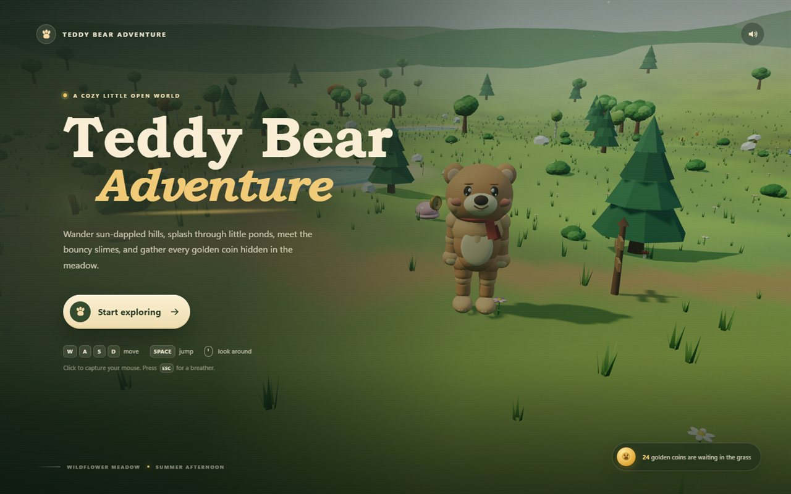
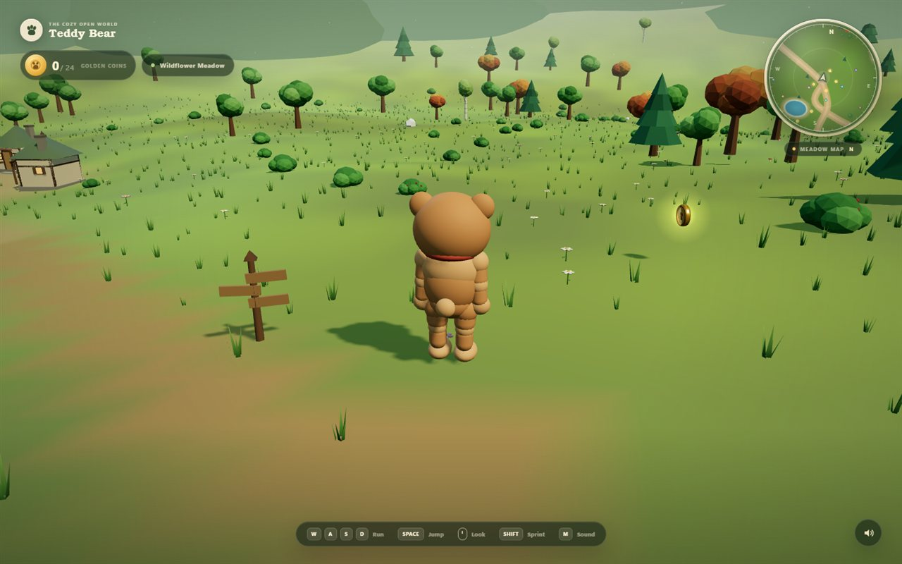

# Teddy Bear Adventure

**[Play the live demo →](https://teddy-bear-adventure.vercel.app)**

A cozy third-person 3D exploration game built with **three.js** and **anime.js**. Wander sun-dappled hills, splash through ponds, meet bouncy slimes, and gather every golden coin hidden in the meadow.

Everything in the world — the bear, trees, villages, ponds, coins, and slimes — is generated procedurally. There are no external art assets to download.



## Features

- A fully rigged, procedurally built teddy bear with idle, run, and jump animations
- Third-person camera with mouse look, zoom, occlusion handling, and character fading
- Rolling terrain with ponds, oak/pine/birch/autumn trees, bushes, flowers, rocks, and drifting clouds
- Three villages with cottages, wells, chimneys, and warm window light
- Hopping slimes and 24 floating, glowing collectible coins
- Rotating minimap that follows the camera heading and shows trees, water, coins, villages, and trails
- Storybook start screen, location banners, coin counter, pause menu, and victory celebration
- Sound effects with a mute toggle, plus reduced-motion support
- Responsive HUD for desktop and mobile



## Controls

| Input | Action |
| --- | --- |
| `W` `A` `S` `D` / arrow keys | Move |
| `Shift` | Sprint |
| `Space` | Jump |
| Mouse | Look around (click to capture the pointer) |
| Mouse wheel | Zoom the camera |
| `Esc` | Pause / release the pointer |
| `M` | Mute or unmute |

## Getting started

Requires [Node.js](https://nodejs.org/) 20 or newer.

```bash
npm install
npm run dev
```

Open http://localhost:5173 in your browser.

### Production build

```bash
npm run build
npm run preview
```

The production bundle is written to `dist/`.

## Project structure

```text
teddy-bear-adventure/
├── docs/                  # README screenshots
├── src/
│   ├── main.js            # Game loop, input, camera, UI flow
│   ├── bear.js            # Procedural skinned bear and animation clips
│   ├── world.js           # World assembly, sky, lighting, trail markers
│   ├── world-data.js      # Terrain heights, ponds, villages, paths, coins
│   ├── world-nature.js    # Trees, bushes, rocks, grass, flowers, colliders
│   ├── world-ponds.js     # Water shader and ripples
│   ├── world-villages.js  # Cottages, wells, and village details
│   ├── world-coins.js     # Collectible coins
│   ├── world-slimes.js    # Hopping slimes
│   ├── minimap.js         # Rotating Canvas minimap
│   ├── audio.js           # Procedural sound effects
│   ├── particles.js       # Ambient particle effects
│   ├── nature-geometry.js # Shared tree and plant geometry
│   ├── geometry-utils.js  # Geometry helpers
│   ├── utils.js           # Math and easing helpers
│   └── style.css          # Storybook UI and responsive layout
├── index.html
└── package.json
```

## Technical notes

- The terrain height is analytic, so the player, camera, props, and minimap all sample the same surface.
- The world uses a seeded RNG for stable, repeatable layouts.
- Trees, grass, and flowers use instancing and merged geometry to keep draw calls low.
- The bear is a custom `SkinnedMesh` with hand-built bones. `AnimationMixer` drives the idle/run/jump clips, while anime.js adds ear and tail motion.
- anime.js also powers the UI transitions, coin animations, and village light twinkles.
- The camera pulls in around houses, wells, and tree trunks, and smoothly fades the bear when it gets too close.

## Built with

- [three.js](https://threejs.org/) — 3D rendering
- [anime.js](https://animejs.com/) — animation
- [Vite](https://vitejs.dev/) — development server and build tooling
